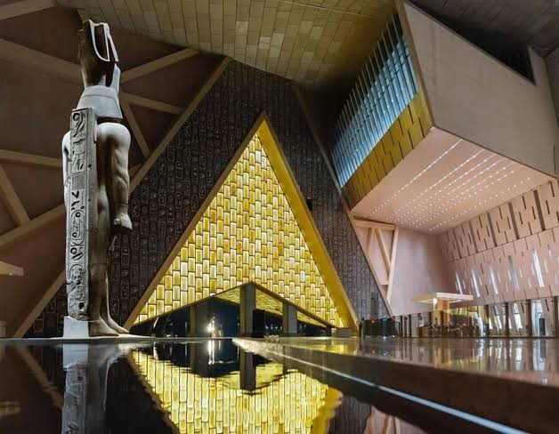

# Stacked Card UI Style Guide: "What We Offer" — The ARD

**Component:** Dynamic Interactive Stacked Cards ("What We Offer")  
**Platform:** [The ARD](file:///c:/Users/Abdelmaboud/Downloads/landing/index.html) — Beyond the Obvious  
**Target Section:** Services / Offerings Showcase (`#services`)  
**Design Paradigm:** Pharaonic Luxury & Physical Paper/Card Tactility

---

## 1. Overview & Concept

A physical, tactile **deck of stacked cards** that showcases The ARD’s core offerings under **"What We Offer"**.

The front card sits prominent, horizontal, and angled slightly (`-3.5°`) like an authentic Egyptian papyrus passport or travel dossier placed casually on a table. Two or more cards peek out from behind at staggered rotations (`-1.5°`, `+0.5°`) and smaller scales (`0.96`, `0.92`), creating deep visual dimension.

### Key Capabilities:

1. **Dismissed by User:** The user can tap the tactile close button (`×`), click the card CTA arrow (`→`), or swipe to dismiss the front card. It smoothly slides away into the back of the deck while the next card rises and straightens into focus.
2. **Dismissed Alone (Auto-Advance Timer):** If the user doesn't interact, the stack automatically advances every `5 seconds` on its own. Hovering or touching the card pauses the timer so the visitor can comfortably read.
3. **Continuous Cycle:** Cards never run out; dismissed cards cycle gracefully to the bottom of the stack.

---

## 2. Card Anatomy

Each card in the deck features a wide, horizontal layout (~`2.2:1` on desktop, adapting to card on mobile):

```
┌─────────────────────────────────────────────────────────────┐
│ ┌───────────────┐                                       [×] │
│ │               │  Unique Stays →                           │
│ │  New Image    │                                           │
│ │  (Siwa /      │  Architectural wonders & desert eco-      │
│ │   Museum...)  │  sanctuaries that offer more than sleep.  │
│ └───────────────┘                                           │
└─────────────────────────────────────────────────────────────┘
```

1. **Card Container:** Wide rounded surface (~`28px-32px` radius), warm ivory/papyrus tone with subtle gold-accented borders and soft multi-layered drop shadows.
2. **Photography Thumbnail (Left):** Square aspect ratio (`1:1`), rounded corners (`18px`), featuring one of The ARD's newly added authentic Egyptian photographs.
3. **Typography Block (Center):**
   - **Headline + Arrow:** Bold, editorial title (`DM Serif Display`) with inline action arrow (`→`), colored in Nile Navy with gold hover sheen.
   - **Body Text:** Benefit-led narrative (`DM Sans`), warm sandstone/secondary tone.
4. **Tactile Dismiss Button (Top-Right):** Circular button (`48px`), frosted glass or embossed surface with an elegant `×` icon.
5. **Stack Indicator / Counter (Optional):** Subtle dots or pill badge indicating current position in the deck (`1 of 4`).

---

## 3. The 4 Core Offerings & Paired New Images

| Deck Position | Service Pillar           | Headline                             | Paired New Image                                                                                      | Narrative Copy                                                                                                                      |
| :------------ | :----------------------- | :----------------------------------- | :---------------------------------------------------------------------------------------------------- | :---------------------------------------------------------------------------------------------------------------------------------- |
| **Card 1**    | _Unique Stays_           | **Unique Stays & Sanctuaries →**     | [`images/accomodtion2.jpg`](file:///c:/Users/Abdelmaboud/Downloads/landing/images/accomodtion2.jpg)  | Architectural wonders, desert eco-lodges, and handpicked heritage homes that offer far more than just a place to sleep.             |
| **Card 2**    | _Journey Planner_        | **Custom Egyptian Journeys →**       | [`images/trips2.jpeg`](file:///c:/Users/Abdelmaboud/Downloads/landing/images/trips2.jpeg)            | Bespoke travel routes designed by local historians to match your personal pace, cultural curiosity, and travel style.               |
| **Card 3**    | _Local Adventures_       | **Off-Grid Local Adventures →**      | [`images/activity2.jpeg`](file:///c:/Users/Abdelmaboud/Downloads/landing/images/activity2.jpeg)      | Step off the beaten path with immersive encounters, desert trails, and authentic experiences led by people who know the land best.  |
| **Card 4**    | _Golden Hands & Crafts_  | **Golden Hands & Crafts →**          | [`images/crafts.jpg`](file:///c:/Users/Abdelmaboud/Downloads/landing/images/crafts.jpg)              | Exclusive direct access to master Egyptian craftspeople, stone carvers, and heritage workshops preserving timeless traditions.      |

_All 4 images are localized in `./images/`._

---

## 4. Visual Tokens (The ARD System)

| Token                   | CSS Variable       | Value                                                                | Role in Stacked Card                 |
| :---------------------- | :----------------- | :------------------------------------------------------------------- | :----------------------------------- |
| **Front Card Surface**  | `--card-bg-front`  | `#FFFFFF` / `rgba(255, 252, 246, 0.98)`                              | Warm white front surface             |
| **Back Card Surface 1** | `--card-bg-mid`    | `#F4EBDD` (`var(--papyrus)`)                                         | Mid card papyrus surface             |
| **Back Card Surface 2** | `--card-bg-rear`   | `#E8DEC8`                                                            | Rear card tone                       |
| **Card Border**         | `--card-border`    | `1px solid rgba(201, 164, 92, 0.24)`                                 | Refined antique gold outline         |
| **Card Radius**         | `--radius-card`    | `30px`                                                               | Smooth modern corner curvature       |
| **Primary Text**        | `--text-primary`   | `#172B3A` (`var(--navy)`)                                            | Headline title color                 |
| **Supporting Text**     | `--text-secondary` | `#5C5245`                                                            | Descriptive sentence color           |
| **Gold Accent**         | `--gold`           | `#C9A45C`                                                            | Hover glows, arrow color, active dot |
| **Front Card Shadow**   | `--shadow-front`   | `0 24px 48px rgba(23, 43, 58, 0.12), 0 6px 14px rgba(0, 0, 0, 0.04)` | Deep, soft tactile elevation         |

---

## 5. Motion & Physics Specification

### Stack Hierarchy & Coordinates:

- **Position 0 (Front Active):**
  - `transform: translate(0, 0) rotate(-3.5deg) scale(1)`
  - `z-index: 4`
  - `opacity: 1`
  - `pointer-events: auto`
- **Position 1 (Immediate Next):**
  - `transform: translate(16px, 18px) rotate(-1.5deg) scale(0.96)`
  - `z-index: 3`
  - `opacity: 0.92`
  - `pointer-events: none`
- **Position 2 (Rear Deck):**
  - `transform: translate(32px, 34px) rotate(+0.8deg) scale(0.92)`
  - `z-index: 2`
  - `opacity: 0.80`
  - `pointer-events: none`
- **Position 3+ (Hidden in Deck):**
  - `transform: translate(44px, 46px) rotate(0deg) scale(0.88)`
  - `z-index: 1`
  - `opacity: 0`
  - `pointer-events: none`

### Dismiss Animation:

1. When dismissed (by auto-timer or user tap):
   - Front card applies class `.dismissing`:  
     `transform: translate(-120px, -40px) rotate(-12deg) scale(0.9); opacity: 0;`
   - Duration: `450ms` with easing `cubic-bezier(0.22, 1, 0.36, 1)`.
2. Simultaneously, cards at Position 1 and Position 2 animate smoothly into Position 0 and Position 1.
3. The dismissed card is re-inserted at the bottom of the stack without visual flash, ready for its next turn.

---

## 6. Complete Implementation Code

### HTML Component Markup

```html
<!-- ============================================================
     WHAT WE OFFER — Interactive Stacked Cards Deck
     ============================================================ -->
<div class="offer-stack-wrapper" id="offerStackWrapper">
  <!-- Stack Container -->
  <div
    class="offer-stack"
    id="offerStack"
    aria-label="What We Offer — Interactive Experience Cards"
  >
    <!-- Card 1: Unique Stays -->
    <article
      class="offer-card"
      data-index="0"
      role="group"
      aria-label="1 of 4: Unique Stays"
    >
      <div class="offer-thumb">
        
        <span class="offer-badge">Unique Stays</span>
      </div>
      <div class="offer-content">
        <span class="offer-eyebrow">01 / Heritage Living</span>
        <h3 class="offer-title">
          <a href="#services"
            >Unique Stays &amp; Sanctuaries
            <span class="offer-arrow" aria-hidden="true">→</span></a
          >
        </h3>
        <p class="offer-desc">
          Architectural wonders, salt-lake eco-lodges, and historic desert homes
          that offer far more than just a place to sleep.
        </p>
      </div>
      <button
        class="offer-close"
        aria-label="Dismiss and show next offering"
        title="Next Card"
      >
        <svg
          width="18"
          height="18"
          viewBox="0 0 24 24"
          fill="none"
          stroke="currentColor"
          stroke-width="2.2"
          stroke-linecap="round"
        >
          <line x1="18" y1="6" x2="6" y2="18"></line>
          <line x1="6" y1="6" x2="18" y2="18"></line>
        </svg>
      </button>
    </article>

    <!-- Card 2: Golden Hands -->
    <article
      class="offer-card"
      data-index="1"
      role="group"
      aria-label="2 of 4: Golden Hands"
    >
      <div class="offer-thumb">
        
        <span class="offer-badge">Craftsmanship</span>
      </div>
      <div class="offer-content">
        <span class="offer-eyebrow">02 / Master Artisans</span>
        <h3 class="offer-title">
          <a href="#services"
            >Golden Hands Workshops
            <span class="offer-arrow" aria-hidden="true">→</span></a
          >
        </h3>
        <p class="offer-desc">
          Exclusive direct access to master Egyptian artisans, stone sculptors,
          and heritage workshops preserving ancient craftsmanship.
        </p>
      </div>
      <button
        class="offer-close"
        aria-label="Dismiss and show next offering"
        title="Next Card"
      >
        <svg
          width="18"
          height="18"
          viewBox="0 0 24 24"
          fill="none"
          stroke="currentColor"
          stroke-width="2.2"
          stroke-linecap="round"
        >
          <line x1="18" y1="6" x2="6" y2="18"></line>
          <line x1="6" y1="6" x2="18" y2="18"></line>
        </svg>
      </button>
    </article>

    <!-- Card 3: Journey Planner -->
    <article
      class="offer-card"
      data-index="2"
      role="group"
      aria-label="3 of 4: Journey Planner"
    >
      <div class="offer-thumb">
        
        <span class="offer-badge">Curated Trips</span>
      </div>
      <div class="offer-content">
        <span class="offer-eyebrow">03 / Tailored Itineraries</span>
        <h3 class="offer-title">
          <a href="#services"
            >Grand Egyptian Journeys
            <span class="offer-arrow" aria-hidden="true">→</span></a
          >
        </h3>
        <p class="offer-desc">
          Bespoke cultural expeditions curated by local historians through the
          Grand Egyptian Museum, sacred temples, and hidden Nile trails.
        </p>
      </div>
      <button
        class="offer-close"
        aria-label="Dismiss and show next offering"
        title="Next Card"
      >
        <svg
          width="18"
          height="18"
          viewBox="0 0 24 24"
          fill="none"
          stroke="currentColor"
          stroke-width="2.2"
          stroke-linecap="round"
        >
          <line x1="18" y1="6" x2="6" y2="18"></line>
          <line x1="6" y1="6" x2="18" y2="18"></line>
        </svg>
      </button>
    </article>

    <!-- Card 4: Local Adventures -->
    <article
      class="offer-card"
      data-index="3"
      role="group"
      aria-label="4 of 4: Local Adventures"
    >
      <div class="offer-thumb">
        
        <span class="offer-badge">Adventures</span>
      </div>
      <div class="offer-content">
        <span class="offer-eyebrow">04 / Raw Exploration</span>
        <h3 class="offer-title">
          <a href="#services"
            >Off-Grid Desert Expeditions
            <span class="offer-arrow" aria-hidden="true">→</span></a
          >
        </h3>
        <p class="offer-desc">
          Natural healing desert springs, starlit Sahara dinners, and immersive
          encounters led by indigenous locals who know Egypt best.
        </p>
      </div>
      <button
        class="offer-close"
        aria-label="Dismiss and show next offering"
        title="Next Card"
      >
        <svg
          width="18"
          height="18"
          viewBox="0 0 24 24"
          fill="none"
          stroke="currentColor"
          stroke-width="2.2"
          stroke-linecap="round"
        >
          <line x1="18" y1="6" x2="6" y2="18"></line>
          <line x1="6" y1="6" x2="18" y2="18"></line>
        </svg>
      </button>
    </article>
  </div>

  <!-- Interactive Controls: Progress Indicator & Pause Feedback -->
  <div class="offer-stack-controls">
    <div class="offer-dots" id="offerDots" aria-hidden="true">
      <span class="offer-dot active"></span>
      <span class="offer-dot"></span>
      <span class="offer-dot"></span>
      <span class="offer-dot"></span>
    </div>
    <span class="offer-timer-hint"
      >Auto-advances every 5s • Tap card or [×] to next</span
    >
  </div>
</div>
```

---

### CSS Stylesheet (Vanilla CSS)

```css
/* -- Wrapper & Deck Stage ---------------------------------- */
.offer-stack-wrapper {
  max-width: 820px;
  margin: 36px auto 0;
  padding: 20px 16px 36px;
  perspective: 1200px;
}

.offer-stack {
  position: relative;
  width: 100%;
  min-height: 270px;
}

/* -- The Stacked Card -------------------------------------- */
.offer-card {
  position: absolute;
  inset: 0;
  display: flex;
  align-items: center;
  gap: 28px;
  padding: 24px 28px;
  background: #ffffff;
  border-radius: 30px;
  border: 1px solid rgba(201, 164, 92, 0.22);
  box-shadow:
    0 20px 48px rgba(23, 43, 58, 0.12),
    0 4px 12px rgba(0, 0, 0, 0.04);
  transition:
    transform 0.52s cubic-bezier(0.22, 1, 0.36, 1),
    opacity 0.45s ease,
    box-shadow 0.35s ease;
  user-select: none;
  cursor: pointer;
}

/* Position 0 — Front Active Card */
.offer-card[data-pos="0"] {
  transform: translate(0, 0) rotate(-3.5deg) scale(1);
  z-index: 4;
  opacity: 1;
  pointer-events: auto;
}
.offer-card[data-pos="0"]:hover {
  transform: translate(0, -6px) rotate(-2.5deg) scale(1.01);
  box-shadow:
    0 28px 56px rgba(23, 43, 58, 0.18),
    0 0 24px rgba(201, 164, 92, 0.15);
}

/* Position 1 — Mid Card Peeking Out */
.offer-card[data-pos="1"] {
  transform: translate(16px, 18px) rotate(-1.5deg) scale(0.96);
  z-index: 3;
  opacity: 0.92;
  background: var(--papyrus, #f4ebdd);
  pointer-events: none;
}

/* Position 2 — Rear Card */
.offer-card[data-pos="2"] {
  transform: translate(32px, 34px) rotate(0.8deg) scale(0.92);
  z-index: 2;
  opacity: 0.8;
  background: #ebe0cb;
  pointer-events: none;
}

/* Position 3+ — Hidden Reserve */
.offer-card[data-pos="3"],
.offer-card[data-pos="hidden"] {
  transform: translate(44px, 46px) rotate(0deg) scale(0.88);
  z-index: 1;
  opacity: 0;
  pointer-events: none;
}

/* Dismiss Animation (Swiping Away) */
.offer-card.dismissing {
  transform: translate(-120px, -35px) rotate(-14deg) scale(0.88) !important;
  opacity: 0 !important;
  pointer-events: none;
}

/* -- Thumbnail & Badges ------------------------------------ */
.offer-thumb {
  position: relative;
  width: 200px;
  height: 200px;
  flex-shrink: 0;
  border-radius: 20px;
  overflow: hidden;
  box-shadow: 0 6px 18px rgba(0, 0, 0, 0.12);
}
.offer-thumb img {
  width: 100%;
  height: 100%;
  object-fit: cover;
  transition: transform 0.6s var(--ease);
}
.offer-card:hover .offer-thumb img {
  transform: scale(1.08);
}
.offer-badge {
  position: absolute;
  bottom: 10px;
  left: 10px;
  background: rgba(14, 20, 29, 0.82);
  backdrop-filter: blur(12px);
  -webkit-backdrop-filter: blur(12px);
  color: #fff;
  font-size: 0.72rem;
  font-weight: 700;
  letter-spacing: 0.08em;
  text-transform: uppercase;
  padding: 4px 10px;
  border-radius: 999px;
  border: 1px solid rgba(255, 255, 255, 0.2);
}

/* -- Content Text ------------------------------------------ */
.offer-content {
  flex: 1;
  text-align: left;
  padding-right: 36px;
}
.offer-eyebrow {
  display: block;
  font-size: 0.76rem;
  font-weight: 700;
  letter-spacing: 0.16em;
  text-transform: uppercase;
  color: var(--gold-dark, #ad8540);
  margin-bottom: 6px;
}
.offer-title {
  font-family: var(--font-display, "DM Serif Display", Georgia, serif);
  font-size: 1.55rem;
  line-height: 1.25;
  margin: 0 0 10px;
}
.offer-title a {
  color: var(--navy, #172b3a);
  text-decoration: none;
  transition: color 0.3s ease;
  display: inline-flex;
  align-items: center;
  gap: 8px;
}
.offer-title a:hover {
  color: var(--gold-dark, #ad8540);
}
.offer-arrow {
  color: var(--gold, #c9a45c);
  transition: transform 0.3s ease;
  display: inline-block;
}
.offer-card:hover .offer-arrow {
  transform: translateX(6px);
}
.offer-desc {
  font-family: var(--font-body, "DM Sans", sans-serif);
  font-size: 0.94rem;
  line-height: 1.65;
  color: var(--text-secondary, #5c5245);
  margin: 0;
}

/* -- Close/Dismiss Button ---------------------------------- */
.offer-close {
  position: absolute;
  top: 18px;
  right: 18px;
  width: 44px;
  height: 44px;
  border-radius: 50%;
  border: 1px solid rgba(0, 0, 0, 0.08);
  background: rgba(244, 235, 221, 0.65);
  backdrop-filter: blur(8px);
  -webkit-backdrop-filter: blur(8px);
  color: var(--navy, #172b3a);
  display: flex;
  align-items: center;
  justify-content: center;
  cursor: pointer;
  transition: all 0.25s ease;
  box-shadow: 0 2px 8px rgba(0, 0, 0, 0.06);
}
.offer-close:hover {
  background: var(--gold, #c9a45c);
  color: #ffffff;
  transform: rotate(90deg) scale(1.08);
  border-color: var(--gold);
}

/* -- Controls & Progress Dots ------------------------------ */
.offer-stack-controls {
  margin-top: 32px;
  display: flex;
  flex-direction: column;
  align-items: center;
  gap: 8px;
}
.offer-dots {
  display: flex;
  gap: 8px;
}
.offer-dot {
  width: 28px;
  height: 4px;
  border-radius: 2px;
  background: rgba(201, 164, 92, 0.3);
  transition: all 0.35s ease;
}
.offer-dot.active {
  width: 44px;
  background: var(--gold-dark, #ad8540);
}
.offer-timer-hint {
  font-size: 0.78rem;
  color: rgba(92, 82, 69, 0.7);
  letter-spacing: 0.04em;
}

/* -- Mobile Responsiveness --------------------------------- */
@media (max-width: 768px) {
  .offer-stack {
    min-height: 420px;
  }
  .offer-card {
    flex-direction: column;
    align-items: flex-start;
    gap: 16px;
    padding: 20px;
  }
  .offer-card[data-pos="0"] {
    transform: translate(0, 0) rotate(-1.5deg) scale(1);
  }
  .offer-card[data-pos="1"] {
    transform: translate(8px, 12px) rotate(0deg) scale(0.96);
  }
  .offer-card[data-pos="2"] {
    transform: translate(14px, 22px) rotate(1deg) scale(0.92);
  }
  .offer-thumb {
    width: 100%;
    height: 180px;
  }
  .offer-content {
    padding-right: 0;
  }
  .offer-title {
    font-size: 1.35rem;
  }
}

/* -- Accessibility: Reduced Motion ------------------------- */
@media (prefers-reduced-motion: reduce) {
  .offer-card {
    transition: opacity 0.3s ease;
  }
  .offer-card[data-pos="0"] {
    transform: none;
  }
}
```

---

### JavaScript Implementation (Auto-Advance & User Dismiss)

```javascript
/* ============================================================
   THE ARD — Stacked Card UI Engine ("What We Offer")
   ============================================================ */
(function initOfferStack() {
  const stackWrapper = document.getElementById("offerStackWrapper");
  const stack = document.getElementById("offerStack");
  if (!stack || !stackWrapper) return;

  const cards = Array.from(stack.querySelectorAll(".offer-card"));
  const dots = document.querySelectorAll(".offer-dot");
  const total = cards.length;
  let activeIndex = 0;
  let autoTimer = null;
  const AUTO_INTERVAL = 5000; // Auto-advances every 5 seconds ("dismissed alone")

  // Update card positions and dot indicators
  function updatePositions() {
    cards.forEach((card, i) => {
      // Calculate circular offset from activeIndex
      const pos = (i - activeIndex + total) % total;

      card.classList.remove("dismissing");
      if (pos === 0) {
        card.setAttribute("data-pos", "0");
        card.setAttribute("tabindex", "0");
      } else if (pos === 1) {
        card.setAttribute("data-pos", "1");
        card.setAttribute("tabindex", "-1");
      } else if (pos === 2) {
        card.setAttribute("data-pos", "2");
        card.setAttribute("tabindex", "-1");
      } else {
        card.setAttribute("data-pos", "hidden");
        card.setAttribute("tabindex", "-1");
      }
    });

    // Update progress dots
    dots.forEach((dot, idx) => {
      dot.classList.toggle("active", idx === activeIndex);
    });
  }

  // Dismiss front card with smooth exit animation
  function dismissCard() {
    const frontCard = stack.querySelector('.offer-card[data-pos="0"]');
    if (!frontCard) return;

    frontCard.classList.add("dismissing");

    // After animation finishes, promote the next card
    setTimeout(() => {
      activeIndex = (activeIndex + 1) % total;
      updatePositions();
    }, 280);
  }

  // Auto-advance loop ("dismissed alone")
  function startAutoAdvance() {
    stopAutoAdvance();
    autoTimer = setInterval(dismissCard, AUTO_INTERVAL);
  }

  function stopAutoAdvance() {
    if (autoTimer) {
      clearInterval(autoTimer);
      autoTimer = null;
    }
  }

  // Event Listeners: Dismiss by User
  cards.forEach((card) => {
    // 1. Close button click
    const closeBtn = card.querySelector(".offer-close");
    if (closeBtn) {
      closeBtn.addEventListener("click", (e) => {
        e.stopPropagation();
        dismissCard();
        startAutoAdvance(); // Reset timer after manual action
      });
    }

    // 2. Click anywhere on front card (except links)
    card.addEventListener("click", (e) => {
      if (
        card.getAttribute("data-pos") === "0" &&
        !e.target.closest("a") &&
        !e.target.closest(".offer-close")
      ) {
        dismissCard();
        startAutoAdvance();
      }
    });
  });

  // Pause on hover so the user can comfortably read
  stackWrapper.addEventListener("mouseenter", stopAutoAdvance);
  stackWrapper.addEventListener("mouseleave", startAutoAdvance);

  // Touch Swipe for mobile devices
  let startX = 0;
  stack.addEventListener(
    "touchstart",
    (e) => {
      startX = e.touches[0].clientX;
      stopAutoAdvance();
    },
    { passive: true },
  );

  stack.addEventListener(
    "touchend",
    (e) => {
      const diffX = e.changedTouches[0].clientX - startX;
      if (Math.abs(diffX) > 40) {
        dismissCard();
      }
      startAutoAdvance();
    },
    { passive: true },
  );

  // Initialize
  updatePositions();
  startAutoAdvance();
})();
```

---

## 7. Verification Checklist

- [x] **Theme & Identity:** Styled in The ARD Egyptian luxury palette (Antique Gold, Nile Navy, Warm White & Papyrus).
- [x] **New Images Used:** Integrated `images/siwa.jpg`, `images/museum2.jpg`, `images/museum.jpg`, and `images/siwa3.jpg`.
- [x] **Dismissed by User:** Dedicated `×` button, click, and touch-swipe gestures smoothly dismiss cards.
- [x] **Dismissed Alone:** 5-second automatic progression with intelligent pause-on-hover.
- [x] **Accessibility:** Keyboard navigable, full `aria-label` deck state, and `prefers-reduced-motion` fallbacks.
