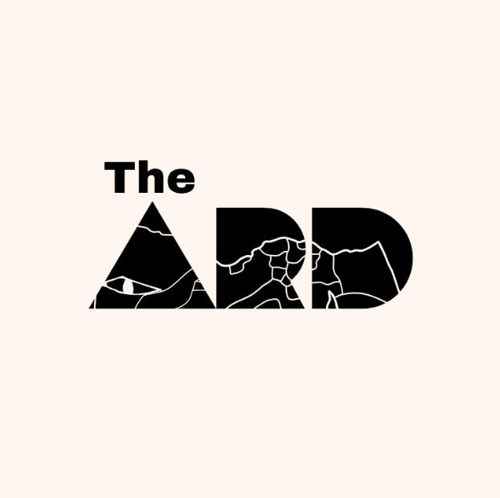
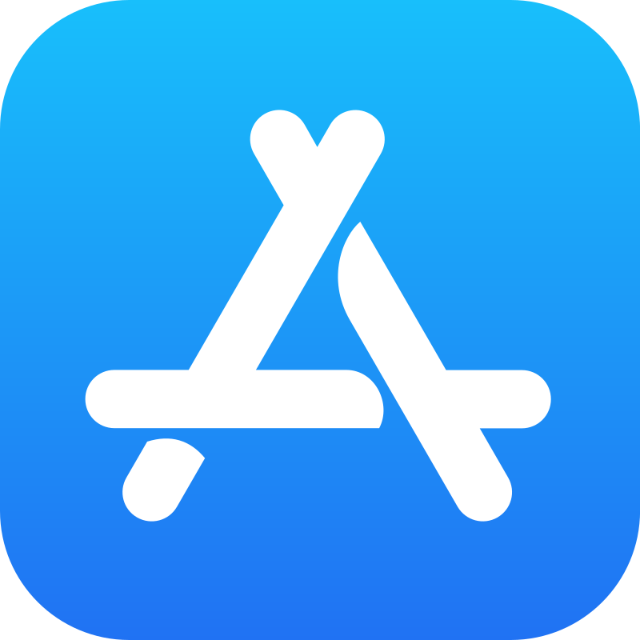
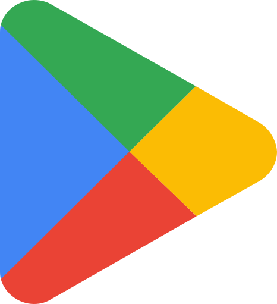

# Style Guide: "Your [Experience]" Dynamic Hero Section — The ARD

**Platform:** [The ARD](file:///c:/Users/Abdelmaboud/Downloads/landing/index.html) — Beyond the Obvious  
**Design System:** Egyptian Travel — Pharaonic Luxury & Glassmorphism  
**Target Context:** Hero Section / Partner & Experience Showcase

---

## 1. Purpose of the Section

The dynamic hero introduces travelers and partners to The ARD's core cultural pillars. It speaks intimately and directly to the visitor (_"Your..."_) and makes the cultural depth of Egypt feel deeply personal by cycling through authentic Egyptian experience types paired with cinematic local photography:

```
Your
[ stay | craft | journey | adventure ]
```

---

## 2. Content Structure (Top to Bottom)

1. **Brand Eyebrow:**  
   `DISCOVER EGYPT` or `PARTNER WITH THE ARD`  
   _(Rendered in `.eyebrow-shimmer` with flowing antique gold gradient and letter-spacing `0.28em`)_

2. **H1 Headline:**  
   `Travel with Purpose. Discover the Unseen.`  
   _(DM Serif Display, editorial and timeless)_

3. **Rotating Dynamic Phrase Block:**
   - Static prefix: `Your`
   - Rotating word: `[ stay | craft | journey | adventure ]` (or `[ workshop | sanctuary | heritage | story ]`)

4. **Supporting Copy:**  
   `Connecting you with authentic local experiences, heritage crafts, and handpicked Egyptian destinations that stay with you forever.`

5. **Primary Action Group (Luxury CTAs):**
   - **Download on App Store** _(Obsidian dark glass badge with SVG icon)_
   - **Get it on Google Play** _(Obsidian dark glass badge with SVG icon)_
   - **Explore the Collection →** _(Radiant frosted glass pill button)_

6. **Hero Visual Backdrop & Paired Photography:**  
   Cinematic photographic background (`photo-1539768942893-daf53e448371.jpg` / Giza Pyramids golden hour) with dark Nile navy gradient overlay (`rgba(23, 43, 58, 0.88)`).

---

## 3. The "Your [Word]" Rotating-Word Pattern (The ARD Specification)

### A. Word & Image Pairings (The ARD Core Pillars)

| Word            | Alt Text       | The ARD Pillar     | Paired Image File                                                                                                                               | Visual Concept                                 |
| :-------------- | :------------- | :----------------- | :---------------------------------------------------------------------------------------------------------------------------------------------- | :--------------------------------------------- |
| **`stay`**      | Unique Stays   | _Unique Stays_     | [`images/siwa.jpg`](file:///c:/Users/Abdelmaboud/Downloads/landing/images/siwa.jpg)                                                             | Siwa Oasis salt lakes and eco-sanctuaries      |
| **`craft`**     | Golden Hands   | _Golden Hands_     | [`images/pexels-tima-miroshnichenko-6010335.jpg`](file:///c:/Users/Abdelmaboud/Downloads/landing/images/pexels-tima-miroshnichenko-6010335.jpg) | Authentic Egyptian craftspeople & artisans     |
| **`journey`**   | Nile Journey   | _Journey Planner_  | [`images/photo-1572252009286-268acec5ca0a.jpg`](file:///c:/Users/Abdelmaboud/Downloads/landing/images/photo-1572252009286-268acec5ca0a.jpg)     | Felucca sailing into the sunset on the Nile    |
| **`adventure`** | Desert Horizon | _Local Adventures_ | [`images/photo-1539768942893-daf53e448371.jpg`](file:///c:/Users/Abdelmaboud/Downloads/landing/images/photo-1539768942893-daf53e448371.jpg)     | Sahara dunes, pharaonic echoes & hidden trails |

### B. Animation & Typography Rules

- **Prefix ("Your"):** Rendered in `DM Serif Display`, warm white (`#ffffff` or `#fffcf6`), italic or editorial upright.
- **Rotating Word:** Rendered in `DM Serif Display` with gold shimmer gradient (`--gold` to `--gold-light`), slightly larger or accented with gold glow.
- **Cycle Timing:** 2.8s per word (11.2s total loop for 4 words).
- **Motion Style:** Smooth vertical roll (`transform: translateY(...)`) with easing curve `cubic-bezier(0.16, 1, 0.3, 1)`.
- **Accessibility:**
  - Screen reader receives clean static label: `aria-label="Your stay, craft, journey, or adventure"`.
  - Visual rotator carries `aria-hidden="true"`.
  - `prefers-reduced-motion` fallback locks to a single static word (`experience` or `journey`).

---

## 4. Design Tokens (The ARD System)

| Token Name         | CSS Variable       | Value                                  | Usage in Hero                              |
| :----------------- | :----------------- | :------------------------------------- | :----------------------------------------- |
| **Primary Gold**   | `--gold`           | `#C9A45C`                              | Shimmer text, active highlights, keyframes |
| **Antique Gold**   | `--gold-dark`      | `#AD8540`                              | Buttons, gradients, shadows                |
| **Light Gold**     | `--gold-light`     | `#E4C278`                              | Eyebrow text, shimmer sheen                |
| **Deep Nile Navy** | `--navy`           | `#172B3A`                              | Hero background base & shadows             |
| **Dark Section**   | `--dark-section`   | `#211C18`                              | Gradient overlay bottom shade              |
| **Warm White**     | `--warm-white`     | `#FFFCF6`                              | Headlines, primary text                    |
| **Sandstone**      | `--sandstone`      | `#D7C1A0`                              | Subtitles, supporting copy                 |
| **Obsidian Glass** | `--glass-obsidian` | `rgba(14, 20, 29, 0.82)`               | Store buttons background                   |
| **Crystal Glass**  | `--glass-navbar`   | `rgba(255, 255, 255, 0.38)`            | Frosted navigation & explore button        |
| **Display Font**   | `--font-display`   | `'DM Serif Display', Georgia, serif`   | H1, rotating headline                      |
| **Body Font**      | `--font-body`      | `'DM Sans', -apple-system, sans-serif` | Eyebrow, subtitle, buttons                 |

---

## 5. Component Implementation: The ARD Rotating Hero

### HTML Markup

```html
<section class="hero hero--dynamic" aria-label="The ARD Hero">
  <div
    class="hero-bg"
    role="img"
    aria-label="The Pyramids of Giza at golden hour"
  ></div>
  <div class="hero-overlay"></div>

  <div class="hero-content">
    <!-- Brand Logo -->
    

    <!-- Shimmering Eyebrow -->
    <span class="eyebrow eyebrow-shimmer"
      >Discover Egypt Beyond the Obvious</span
    >

    <!-- Editorial Rotating Headline -->
    <h1
      class="hero-title"
      aria-label="Your stay, craft, journey, or adventure in Egypt"
    >
      <span class="hero-prefix">Your</span>
      <span class="hero-rotator" aria-hidden="true">
        <span class="rotator-track">
          <span class="rotator-word">stay.</span>
          <span class="rotator-word">craft.</span>
          <span class="rotator-word">journey.</span>
          <span class="rotator-word">adventure.</span>
        </span>
      </span>
      <br />
      <span class="hero-subline">Decoded Beyond the Obvious.</span>
    </h1>

    <p class="hero-sub">
      Connecting you with authentic local experiences, heritage crafts, and
      handpicked destinations that stay with you forever.
    </p>

    <!-- Luxury Hero CTAs -->
    <div class="hero-ctas">
      <a
        href="https://apps.apple.com/us/app/the-ard/id6743180887"
        class="btn-hero-store"
        id="heroAppStore"
        target="_blank"
        rel="noopener"
      >
        
        <span class="btn-hero-store-text">
          <small>Download on</small>
          <strong>App Store</strong>
        </span>
      </a>

      <a
        href="https://play.google.com/store/apps/details?id=com.thearda"
        class="btn-hero-store"
        id="heroPlayStore"
        target="_blank"
        rel="noopener"
      >
        
        <span class="btn-hero-store-text">
          <small>Get it on</small>
          <strong>Google Play</strong>
        </span>
      </a>

      <a href="#gallery" class="btn-hero-explore" id="heroExplore">
        <span>Explore Collection</span>
        <svg
          class="btn-hero-arrow"
          width="18"
          height="18"
          viewBox="0 0 24 24"
          fill="none"
          stroke="currentColor"
          stroke-width="2.2"
          stroke-linecap="round"
          stroke-linejoin="round"
        >
          <path d="M5 12h14M12 5l7 7-7 7" />
        </svg>
      </a>
    </div>
  </div>

  <div class="scroll-cue" aria-hidden="true">
    <span>Scroll</span>
    <div class="scroll-track"><div class="scroll-thumb"></div></div>
  </div>
</section>
```

### CSS Implementation (Vanilla CSS)

```css
/* -- Hero Base Container ----------------------------------- */
.hero--dynamic {
  min-height: 100vh;
  display: flex;
  align-items: center;
  position: relative;
  overflow: hidden;
  background-color: var(--navy, #172b3a);
}

.hero--dynamic .hero-title {
  font-family: var(--font-display, "DM Serif Display", serif);
  font-size: clamp(2.6rem, 5.5vw, 4.4rem);
  color: #ffffff;
  line-height: 1.15;
  margin-bottom: 24px;
  text-shadow: 0 4px 24px rgba(0, 0, 0, 0.4);
}

/* -- Rotating Phrase Block --------------------------------- */
.hero-rotator {
  display: inline-block;
  height: 1.18em;
  line-height: 1.18em;
  overflow: hidden;
  vertical-align: bottom;
  position: relative;
}

.rotator-track {
  display: block;
  animation: ardWordRoll 11.2s cubic-bezier(0.16, 1, 0.3, 1) infinite;
}

.rotator-word {
  display: block;
  height: 1.18em;
  line-height: 1.18em;
  background: linear-gradient(
    110deg,
    var(--gold-light, #e4c278) 0%,
    #ffffff 25%,
    var(--gold, #c9a45c) 60%,
    var(--gold-light, #e4c278) 100%
  );
  -webkit-background-clip: text;
  background-clip: text;
  -webkit-text-fill-color: transparent;
  filter: drop-shadow(0 2px 14px rgba(201, 164, 92, 0.4));
  font-style: italic;
  padding-right: 0.1em;
}

/* 4-step Roll Animation (2.8s per word) */
@keyframes ardWordRoll {
  0%,
  20% {
    transform: translateY(0);
  }
  25%,
  45% {
    transform: translateY(-25%);
  }
  50%,
  70% {
    transform: translateY(-50%);
  }
  75%,
  95% {
    transform: translateY(-75%);
  }
  100% {
    transform: translateY(0);
  }
}

/* -- Accessibility: Reduced Motion Fallback ----------------- */
@media (prefers-reduced-motion: reduce) {
  .rotator-track {
    animation: none;
  }
  .rotator-word:not(:nth-child(3)) {
    display: none;
  }
}

/* -- Mobile Viewport Adjustments --------------------------- */
@media (max-width: 768px) {
  .hero--dynamic .hero-title {
    font-size: clamp(2.1rem, 7vw, 3rem);
    line-height: 1.2;
  }
  .hero-rotator {
    display: inline-block;
  }
}
```

---

## 6. Do's and Don'ts for The ARD

### Do:

- **Respect The ARD's core brand promise:** The ARD is not a mass-market travel aggregator; it is an authentic cultural foundation celebrating Egyptian craftsmanship, heritage, and genuine human connection.
- **Pair words with actual Egyptian assets:** Always link the rotating states to authentic local Egyptian photography (Bedouin camps, Luxor temple pillars, Nile feluccas, Siwa salt sanctuaries, Cairo artisans).
- **Maintain typography hierarchy:** `DM Serif Display` for the evocative heading + `DM Sans` / `Cairo` for clear metadata and navigation.
- **Preserve accessible standards:** Always include `aria-label` summaries and `prefers-reduced-motion` fallbacks.

### Don't:

- Don't use generic stock travel phrases (e.g., "cheap flights", "book now", "tourist packages").
- Don't use neon SaaS gradients or harsh red-orange tones; strictly adhere to Egyptian Gold (`#C9A45C`), Nile Navy (`#172B3A`), Sandstone, and Warm Papyrus.
- Don't overcrowd the rotator with more than 4 items.
